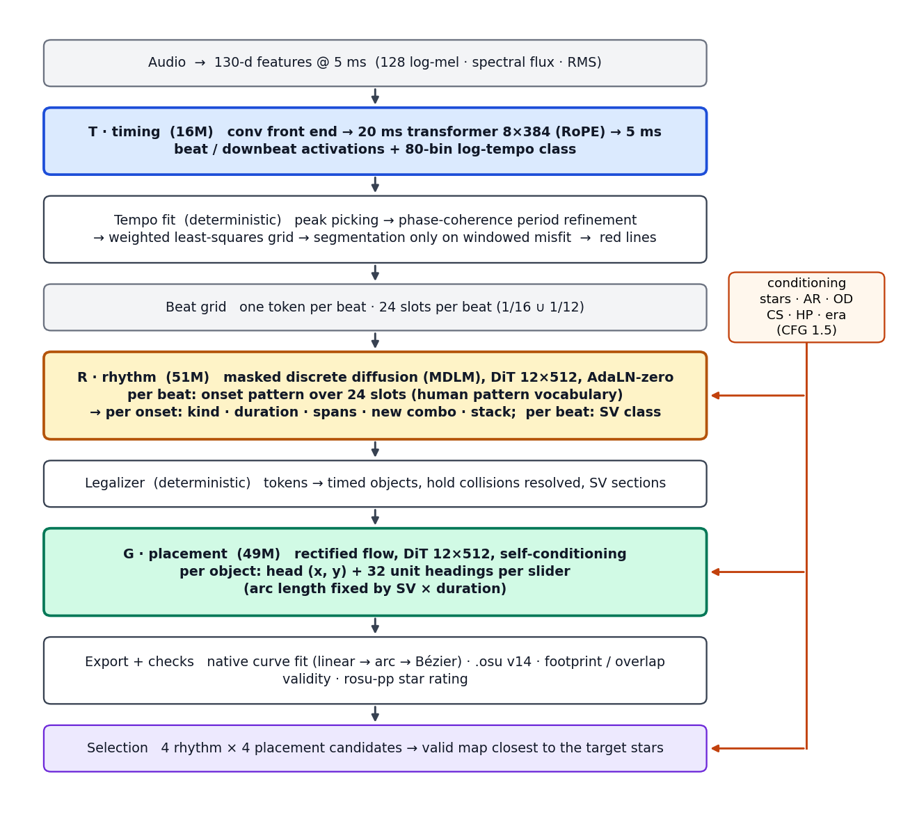

# osu! beatmap generator — v3 cascaded diffusion

Audio → playable osu!standard beatmap. v3 is a three-stage cascade, trained from scratch on about 130k ranked
charts:

- **T** predicts a beat grid from the audio.
- **R** generates the rhythm on that grid with masked discrete diffusion.
- **G** generates positions and slider shapes with rectified flow.

On a 300-chart held-out set, v3 beats the public osu-dreamer checkpoint on onset F1, short-interval
rhythm, star-rating control and most style distances. Its fast-pattern recall is at the human-vs-human level.

> Output is a **draft for human review**. osu!'s Ranking Criteria prohibit generated hit objects and timing in Ranked maps.



## Results (val300, Phase 4)

300 held-out charts, one map per chart, each generated with that chart's own stars / AR / OD / CS / HP / era.
Every system gets the same budget of 16 candidates and the same selection rule (valid, then closest to target
stars). Intervals are 95% song-grouped bootstrap. `human-other` scores a second human mapper's chart against the
reference. Only 73 of the 300 charts have such a partner within 0.5★, so this row is a ceiling estimate on a
subset. Full table: [docs/v3/results/val300.md](docs/v3/results/val300.md).

| System | F1@10 ms | F1@25 ms | ≤¼-beat pair recall | Valid | Star MAE |
|---|---|---|---|---|---|
| human vs human (73 charts) | 0.707 [0.667, 0.742] | 0.732 [0.705, 0.759] | 0.516 [0.396, 0.628] | 1.000 | 0.275 |
| **v3 full (T → R → G)** | **0.571** [0.549, 0.592] | **0.632** [0.616, 0.647] | **0.506** [0.466, 0.541] | **1.000** | **0.127** |
| v3, oracle grid (human red lines) | 0.639 [0.624, 0.655] | 0.639 [0.625, 0.656] | 0.509 [0.469, 0.543] | 1.000 | 0.128 |
| v3, oracle grid, human-only G (G0) | 0.639 [0.624, 0.655] | 0.640 [0.625, 0.655] | 0.507 [0.469, 0.541] | 1.000 | 0.136 |
| osu-dreamer v8 (public checkpoint) | 0.484 [0.464, 0.503] | 0.615 [0.599, 0.629] | 0.340 [0.287, 0.393] | 0.997 | 0.300 |
| osu-dreamer v8, fine-tuned on our pilot set | 0.482 [0.461, 0.501] | 0.617 [0.601, 0.631] | 0.325 [0.272, 0.381] | 0.997 | 0.276 |
| osu-dreamer, trained from scratch on our pilot set | 0.268 [0.242, 0.293] | 0.346 [0.314, 0.375] | 0.025 [0.014, 0.037] | 0.637 | 0.198 |

Style: paired excess distance over the human reference on the same songs. 0 means human-level, lower is better.

| Metric | human-other | v3 full | osu-dreamer v8 |
|---|---|---|---|
| snap-divisor JS | 0.000 | **0.001** | 0.434 |
| rhythm trigram JS | 0.000 | **0.029** | 0.457 |
| spacing W1 | 0.025 | **0.099** | 0.146 |
| turn-angle W1 | −0.020 | 0.062 | 0.068 |
| stack-rate diff | 0.015 | **0.080** | 0.153 |
| slider curve-type JS | 0.000 | **0.023** | 0.116 |
| slider length W1 (px) | 2.5 | 26.1 | 23.3 |
| density W1 (objects/min) | 0.4 | 21.8 | **−3.0** |
| SV changes W1 (/min) | −0.1 | **4.2** | 67.0 |
| new combo on downbeat diff | −0.02 | **0.14** | 0.56 |

**Findings**

- **Grid-native rhythm is the main advantage.** osu-dreamer emits continuous-time signals, which never snap to
  the divisors mappers use. v3 is at human level on snap distribution and fast-pattern recall.
- **The learned timing stage costs little at 25 ms:** 0.639 → 0.632. At 10 ms it costs more (0.639 → 0.571),
  roughly the spread between human mappers' own offsets for the same song (onset-lag IQR 7 ms across human grids).
- **Rejection sampling, not the model, gives sub-human star error.** The first candidate alone has a star MAE of
  0.31–0.32.
- **Teacher-generated geometry did not measurably help G.** G (human + synthetic) and G0 (human-only) are
  indistinguishable on every metric.
- **Known gaps:**
  - R over-generates by about 13% (density excess +21/min, the one metric osu-dreamer wins);
  - slider length and new-combo placement are the largest style distances;
  - oracle-grid spacing W1 has a heavily skewed interval that points to a few outlier charts; this is under
    investigation.
- **The osu-dreamer v8 comparison has a caveat:** v8's pretraining set is unknown and may overlap val300, which
  would only favour it.

## Architecture

All three learned stages share one block design: a pre-norm DiT with RMSNorm, SwiGLU, RoPE and AdaLN-zero
conditioning, using PyTorch SDPA attention. Each stage has its own dilated depthwise-conv front end over shared
130-d audio features. The features are 128 log-mel bands, spectral flux and RMS at 22.05 kHz with hop 110
(≈4.99 ms).

**T — timing (16M parameters, 8×384).**
- *Network:* conv front end at 5 ms, stride-4 downsample to a 20 ms transformer, transposed conv back to 5 ms
  with a skip connection.
- *Outputs:* per-frame beat and downbeat logits, plus an 80-bin log-tempo class.
- *Labels:* osu! red lines, so the tempo head learns which tempo octave a mapper would choose.
- *Tempo fit:* precision comes from a deterministic fit in [src/v3/infer/tempo.py](src/v3/infer/tempo.py), not
  the network:
  1. Peak picking.
  2. Per-candidate period refinement by phase coherence.
  3. Weighted least-squares grid fit, scored by a strong-peak coverage term.
  4. Segmentation into multiple red lines only when some 8 s window stops fitting a single grid.

**R — rhythm (51M parameters, 12×512): masked discrete diffusion (MDLM).**
- *Tokens:* one token per beat. Each beat has 24 slots, the union of 1/16 and 1/12, so ¼-beat doubles and
  triplets are explicit tokens.
- *Per-beat state:*
  - an onset pattern from a vocabulary of 119 human patterns, which covers 99.95% of training beats;
  - for each onset: kind, duration class, repeat count, new combo, stack;
  - a slider-velocity class per beat.
- *Unmasking order:* attributes stay masked until their beat's pattern is revealed.
- *Audio input:* sampled at the 24 slot times of every beat.
- *Sampling:* 32 steps with classifier-free guidance (scale 1.5).
- *Legalizer:* a rule-based legalizer turns tokens into timed objects and resolves hold collisions.

**G — placement (49M parameters, 12×512): rectified flow.**
- *State per object:* head (x, y), plus 32 unit heading vectors at equal arc-length steps for sliders.
- *Slider length:* pixel length is given by SV × duration, so path length is exact by construction:
  `path = head + cumsum(heading · L / 32)`.
- *Training:* velocity prediction with self-conditioning.
- *Constrained sampling:* late in sampling, the predicted clean state is projected and re-noised consistently.
  The projection enforces exact stacks and translates combo groups into the legal footprint (heads inside
  512×384, slider bodies inside osu!'s visible area).
- *Training data:* human charts plus flagged teacher-generated geometry variants. G0 is the matched human-only
  ablation.

**Export and selection.**
- *Export:* native curve fitting (linear → perfect arc → Bézier), red and green lines, `.osu` v14.
- *Checks:* footprint and overlap validity, and rosu-pp star rating.
- *Selection:* 4 rhythm × 4 placement candidates. The valid candidate closest to the target stars wins.

## Data

Built by Phase 0 ([src/v3/data](src/v3/data)) from public ranked-map archives.

- **Scale:** 34,413 songs.
  - Rhythm: 130,617 train / 5,873 val / 5,741 test charts.
  - Placement: 132,492 human charts, plus 124,630 synthetic geometry variants in train only.
  - Timing: 96,068 train charts.
- **Leakage control:** cross-split duplicates are found by binary audio fingerprints, robust to trims and
  tempo/pitch-warped versions such as nightcore. Splits are song-grouped. 440 leak groups
  were removed from evaluation.
- **Offset audit:** a per-source and per-encoder offset audit corrects encoder-delay offsets; 258 songs with
  unreliable offsets are quarantined.
- **Pre-flight gates:** grid coverage, objects on grid, and slider-path round trips must pass before any GPU
  training starts.

## Training

| Stage | Steps | GPU-h (A100 40GB) | Selection metric |
|---|---|---|---|
| T | 113k | 20 | grid drift pass rate (the released checkpoint); now the offset-invariant shape-pass rate |
| R | 405k | 40 | onset F1@25 on fixed validation crops |
| G / G0 | 373k / 371k | 35 / 35 | spacing / turn W1 + out-of-bounds rate |

- 2-GPU DDP with bf16 autocast (weight-cast cache disabled so the no-grad self-conditioning pass keeps gradients).
- AdamW with a warmup-stable-decay schedule (linear decay over the last 20% of steps), EMA weights for evaluation.
- The step budget comes from a throughput probe and a GPU-hour budget.
- Every run is crash-safe and resumable from `last.pt`, and runs from an immutable source snapshot.
- On Slurm, training starts only after a full-data sweep (every chart's first, last and random crop) and a
  2-rank bf16 DDP smoke test pass.

## Usage

```bash
# Inference: one difficulty; writes .osu, .osz and report.json
python -m src.v3.infer.pipeline --audio song.mp3 --out out/song --stars 5.0 \
    --timing runs/v3-timing-base --rhythm runs/v3-rhythm-base --placement runs/v3-placement-base \
    --title "Title" --artist "Artist"          # --candidates 4x4  --cfg 1.5  --seed 0

# Training a stage
python -m src.v3.train.run rhythm --run-dir runs/v3-rhythm-base --data $V3_DATA_ROOT --budget-gpu-hours 40

# Tests
python -m pytest tests/v3
```

Inference needs about 3.5 GB of GPU memory and takes 10–45 s per song on an L40S. It also runs on CPU, much
more slowly. The Slurm drivers in [scripts/amarel/v3](scripts/amarel/v3) cover Phase 0, training
(`submit_training.sh`), evaluation (`submit_eval.sh`) and progress (`status.sh`).

## Layout

| Path | Contents |
|---|---|
| `src/v3/data` | Phase 0: audio features, chart parsing, grid encoding, dedup, offset audit, manifests |
| `src/v3/models` | `timing.py`, `rhythm.py`, `placement.py`, shared `blocks.py` |
| `src/v3/train` | trainer (`loop.py`), per-stage data and losses, pre-flight sweep |
| `src/v3/infer` | tempo fit, legalizer, export, end-to-end pipeline |
| `src/v3/eval` | val300 harness, osu-dreamer adapter, metrics, song-grouped bootstrap |
| `docs/v3` | architecture figure and evaluation results |
| `docs/legacy` | v1/v2 history ([README-v2](docs/legacy/README-v2.md)) |

## Status and next steps

Phases 0–4 of the plan are complete: data, evaluation harness, pilot, training, and integration plus evaluation.
Open items:

- density calibration for R;
- the spacing outliers;
- realism-classifier and memorization metrics;
- audio-intervention tests;
- ablations (era conditioning, R scale or seed);
- the one-time held-out test-set run with a blind A/B.
