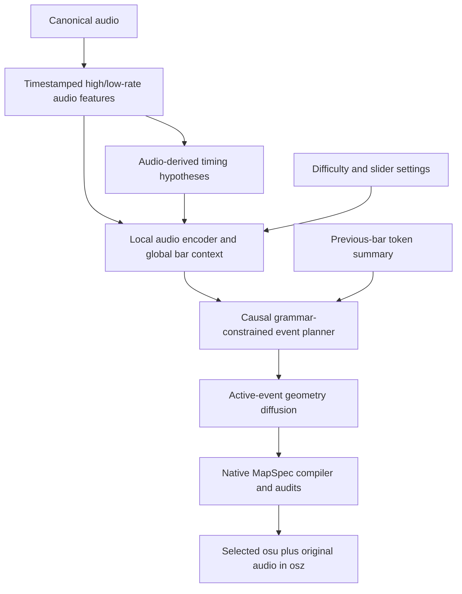

# Architecture explained — `architecture-v2-hierarchical-beatgrid`

Prepared **October 24, 2026**. Source snapshot before this documentation commit: `d75f6a833a438850ce83f7d9e2c935253ddf782a`.

**Branch focus:** Sparse V2 event planning, local-audio alignment and active-event geometry diffusion.

This is the preserved October 16 V2 comparison baseline, before the October 17 coverage/rhythm-flow additions.

This file describes the implementation actually present in this branch. A Git branch
is a source snapshot, not necessarily one neural network: older experiments remain
in the tree. Defaults below are constructor/CLI defaults unless explicitly marked
as a recorded run or preset. Checkpoint configuration can override them.

## 1. Model-family inventory and reading guide

| Family | Present here? | Role and generation output |
| --- | --- | --- |
| Legacy AST + autoregressive tokens | Yes | Absolute grid positions plus residuals; legacy `.osu` generation |
| Legacy auxiliary distance head | No | Exists only on the two distance branches |
| Sparse V2 planner + geometry diffusion | Yes | Grammar event plan → native coordinates/slider paths → audited `.osz` |
| V2 coverage and rendered-path repair | No: later change | Inference/audit safeguards, not another learned network |
| Five-channel rhythm conditional flow | No: later experiment | Timing/hold signals and event JSON; no native geometry or `.osz` |
| Nine-channel AE + latent flow | Yes, historical | Compressed chart/cursor-signal generation and heuristic object decoding |
| Early two-lane V2 grid model | Yes, retained prototype | Not the model instantiated by the operative sparse V2 trainer |

Read sections **2–3** for the original autoregressive/spacing question, **4** for
the complete sparse V2 pipeline, **5** for rhythm-only flow, **6** for the older
latent experiment, and **8–10** for terminology, evaluation and unimplemented ideas.

## 2. Original autoregressive AST/token architecture

Source: [audio encoder and autoregressive decoder](src/model.py),
[tokenizer](src/tokenizer.py), [dataset and collator](src/dataset.py),
[training](src/train.py), [generation](src/inference.py).

### 2.1 Audio input and features

Audio is decoded to mono at 22,050 Hz. A mel spectrogram uses FFT size 2,048,
hop 441 samples (20 ms), and 128 mel bands. A librosa onset-strength channel
is appended, producing 129 input features per frame. The dataset applies log
conversion and normalization, normalizing mel and onset channels separately.
The collated tensor is normally `[B, 1, 129, F]`; six seconds produces about
301 frames. `B` is batch size and `F` is the audio frame count.

The normal token-window dataset uses six-second audio context, three-second
stride and a three-second center prediction interval starting 1.5 seconds into
the context. It does not supervise the whole six-second window as generated
output. Cached WebDataset shards store mel tensors, tokens/residuals, metadata
and optionally the older continuous signal representation.

### 2.2 Audio Spectrogram Transformer encoder

`AudioEncoder` loads `MIT/ast-finetuned-audioset-10-10-0.4593`, an AudioSet-pretrained
AST. The default width is 768, with the pretrained AST's 12-layer backbone.
Most AST parameters are frozen; by default the final two encoder layers are
unfrozen. This is audio pretraining, not an encoder pretrained to understand osu!
mapping decisions.

The 128 mel channels enter AST. Its patch-token output goes through a temporal
upsampling head: two kernel-3 Conv1d layers with GELU, linear interpolation with
factor 2, and LayerNorm. The upsampled sequence remains width 768.

A second path projects **all 129 features**, including onset strength, with a
linear layer. It is interpolated to match the AST-path sequence length. A learned
`Linear → Sigmoid` gate adds that projected sequence to the AST path:

```text
encoder_memory = upsampled_AST + gate(projected_features) * projected_features
```

This is additive gated fusion, not a choice of one branch or the other. Positional
embeddings are resized when the AST patch-grid shape changes. A pretrained-load
failure can construct a randomly initialized AST; an AST-forward failure can fall
back to the projected-feature path and print a warning. Those fallback paths do
not establish pretrained-audio quality and should be checked in actual run logs.

### 2.3 Difficulty/BPM conditioning

`ConditioningEncoder` adds a five-category difficulty embedding to a projection
of `log(BPM) / log(300)`, then normalizes it. This produces `[B, 1, 768]` and is
prepended to audio memory for cross-attention.

The legacy mapping is `<2`, `<3`, `<4`, `<5.3`, and `>=5.3` stars. Thus two requested
star values inside the same category do not become distinct continuous star
conditions in this original token model. A requested 4.5-star map is not guaranteed
to measure 4.5 stars after generation. The older latent-flow model described later
adds a separate continuous difficulty projection.

### 2.4 Autoregressive decoder and output heads

Default decoder configuration:

| Component | Setting |
| --- | --- |
| Token embedding width | 768 |
| Decoder blocks | 6 |
| Attention heads | 8 |
| Feed-forward width | 2,048 |
| Dropout | 0.1 |
| Learned token positions | Up to 2,048 |
| Discrete vocabulary | 1,166 |

A learned token embedding plus learned sequence-position embedding enters a
pre-norm `TransformerDecoder`. Causal self-attention prevents access to future
output tokens; cross-attention reads the audio-plus-conditioning memory. A final
LayerNorm feeds a vocabulary classifier and three scalar regression heads:

```text
shared hidden state h_i
  ├─ discrete_head → next-token logits [B, L, 1166]
  ├─ time_res_head → timing residual [B, L, 1]
  ├─ x_res_head    → X residual [B, L, 1]
  └─ y_res_head    → Y residual [B, L, 1]
```

The distance-equipped branches add another training head, described in section 3.
The baseline architecture does not contain that head. `L` is decoder-prefix length.
Architecture CLI settings can override these defaults; checkpoints and run records
must be consulted before assigning a parameter count to a particular run.

### 2.5 Tokens, coordinates and timing

The first 14 vocabulary entries are special/type/curve tokens. Then come 1,024
absolute-position cells and 128 beat-delta bins. Tokens include BOS/EOS/PAD/SEP,
circle, slider head/control/end, spinner start/end, and Bezier/linear/perfect/
Catmull curve categories.

The playfield is 512 × 384 pixels. Its 32 × 32 grid has 16 × 12 pixel cells:

```text
position_token = POS_OFFSET + cell_y * 32 + cell_x
x = (cell_x + 0.5) * 16 + x_residual
y = (cell_y + 0.5) * 12 + y_residual
```

X/Y residuals are small signed corrections around a cell center, normally bounded by ±8 and ±6
pixels in the collated targets. They are **not** displacement from the previous
object. Position token IDs are category indices, not a scalar physical distance.
There are no explicit left/right movement tokens. Direction is implicit in the
relation between consecutive reconstructed absolute coordinates.

Timing tokens describe nonnegative deltas in **beats**, at 1/16-beat spacing;
128 bins cover 0 through 127/16 beats. A bounded residual refines that delta.
`Residuals.time_offset_ms` is a historical misnomer: in this token path its stored
value is in beats. Conversion back to milliseconds multiplies by `60000 / BPM`.
This legacy path uses one BPM, not V2's native piecewise tempo/SV representation.

A typical circle is `BEAT_DELTA → CIRCLE → POSITION`; sliders add a curve category,
control-point markers/positions, and an end marker/position. The tokenizer bounds
slider controls at eight. These are symbolic serialization tokens, not one neural
coordinate vector per every token: type/time tokens do not themselves identify
an object's geometric location.

### 2.6 Training and loss

Teacher forcing supplies `tokens[:, :-1]` and predicts `tokens[:, 1:]`. Default
objective weights are:

```text
L_existing = 0.8 * token_cross_entropy + 0.2 * residual_loss
residual_loss = mean(time_SmoothL1, x_SmoothL1, y_SmoothL1)
```

PAD is excluded from token CE. The preserved residual implementation zeros padded
positions and averages over its tensor extent; it is not a newly redesigned,
eligible-token-only regression objective. Continuous reference residuals are
regression targets, not extra decoder-prefix input features. Consequently history
provides quantized position tokens rather than exact previous residual coordinates.

Training uses AdamW, gradient clipping, gradient accumulation, BF16 autocast on
CUDA and the existing AMP scaler. The legacy scheduler is cosine annealing with
warm restarts. Logged teacher-forcing ratios do not implement scheduled sampling;
the actual loop remains teacher-forced. Cached-path training and streaming
curriculum behavior must not be confused. The legacy entry point has **no DDP
implementation**; starting several torchrun workers would not create correct
synchronized training.

### 2.7 Generation and native-output limitations

Generation encodes audio once, starts at BOS, and repeatedly runs the decoder on
the complete growing prefix. This original implementation does not use V2's KV
cache. The default generation budget is 512 tokens per window. With ordinary
sampling it temperature-scales logits and uses multinomial sampling; the
`beam_size > 1` path is argmax, not a full beam-search algorithm. Generation ends
at EOS or the token budget and is also bounded by learned positional capacity.

Full-song inference stitches center prediction intervals from overlapping audio
windows. The historical initial center-window gap and final-window handling are
limitations, not proof of complete audible coverage. The original detokenizer
clamps coordinates and can skip malformed token combinations. It is not V2's
strict grammar-constrained native compiler. In particular, legacy slider decoding
uses fixed length 100 and repeat count 1; the encoded slider-end position does not
supply a faithful general native slider-duration model.

Standalone legacy inference writes `.osu` text. Packaging `.osu` plus original
audio into `.osz` is deterministic application work, not another learned output
head. An archive opening successfully in osu! is different from its timing,
geometry, difficulty and musical choices being good.

## 3. Distance supervision status on this branch

This snapshot does **not** contain `src/legacy_distance.py`, an auxiliary
`decoder.distance_head`, distance targets in the legacy collator, or the legacy
distance-training CLI. The original token model must infer spatial relations from
its absolute position-token history and coordinate residual targets.

The distance-supervision change lives on `codex/legacy-distance-aux` and
`codex/legacy-distance-ilab`. It is a training-only addition to that original
model; it should not be confused with V2's existing spacing losses or with the
rhythm-only flow experiment. Those are different modules and objectives.

## 4. V2: sparse autoregressive event planner plus geometry diffusion

The operative V2 trainer imports [SparseEventPlanner](src/v2/sparse_model.py) and
[ActiveEventGeometryDiffuser](src/v2/geometry.py). The branch name includes
"beatgrid", but the production path is now an ordered sparse-event grammar,
not the earlier independent two-lane grid prototype in `src/v2/model.py`.



### 4.1 Audio features and clock hypotheses

The implemented extractor uses canonical 24 kHz mono audio. Its high-rate stream
has 101 features at 100 Hz: 96 normalized log-mel bands and five auxiliaries
(onset strength, normalized RMS, spectral flux, onset×flux and RMS×onset).
The low-rate stream pools mel frames at approximately 25 Hz and expands/repeats
channels to width 128. Despite the code name `semantic_features`, this is **pooled
mel**, not MERT, stems, MIDI, instrument recognition or a learned semantic model.

Streams have explicit millisecond timestamps and content hashes. Canonical PCM
identity and feature pipeline signature are separate concerns. [Audio manifests](src/v2/audio.py)
and [real feature adapter](src/v2/inference.py) bind provenance to reproducible
settings; importing model modules does not silently acquire audio models.

[Clock contracts](src/v2/clock.py) represent BPM/tempo changes, meter, offset and
confidence as timing hypotheses. A beat is mapped through the piecewise timing
map; tensor length is not stretched to an assumed beat count. The native parser
also retains slider velocity/timing information. Training records currently use
human/oracle clocks. Generation instead receives audio-estimated hypotheses, so
clock error is a real train/inference mismatch. The interface for a beat/downbeat
tracker is not proof that a pretrained tracker is installed or active.

### 4.2 Default sparse planner dimensions

| Configuration field | Default |
| --- | ---: |
| Rhythm / pooled-feature widths | 101 / 128 |
| Profile / clock feature widths | 6 / 4 |
| Planner hidden width | 768 |
| Learned local rhythm width | 384 |
| Local temporal blocks | 4 |
| Global bar Transformer layers | 3 |
| Causal token decoder layers | 7 |
| Attention heads | 12 |
| Feed-forward width | 2,560 |
| Boundary GRU layers | 1 |
| Maximum bars / decoder tokens | 512 / 2,048 |
| Local audio tokens in bare config | 0 |
| Local audio tokens in alignment preset | 128 |

The six profile values encode target stars, AR, CS, a combined OD/HP component,
slider multiplier and slider tick rate. Slider settings use bounded log scaling.
This is compact conditioning, not a full independent parameter for every osu!
difficulty field. A profile star target is not an official difficulty calculation.

`TimestampedAudioEncoder` projects rhythmic and pooled streams to 384 dimensions
each. Four masked temporal blocks process the high-rate stream using depthwise
kernel-5 convolution with dilations 1/2/4/8, gated pointwise mixing, residuals and
dropout. Mask-aware per-channel normalization excludes padded frames. Timestamp
interpolation samples both streams at bar query times; concatenation, projection,
GELU and LayerNorm produce width-768 bar descriptors.

Learned bar positions and profile/clock embeddings are added. A three-layer
TransformerEncoder builds whole-song bar context. In the baseline local-token-zero
path, one sampled descriptor per bar is the decoder's coarse audio memory.

### 4.3 Local-audio alignment extension

[The explicit preset](configs/v2_audio_alignment_planner.json) sets
`local_audio_tokens=128`; the dataclass default stays zero for old checkpoints.
For the current target bar, 128 evenly spaced **beat-space** queries are mapped
individually into milliseconds, including tempo changes within a bar. Clock
queries use float64 to preserve tiny meter-transition intervals; feature/model
arithmetic retains its configured dtype.

At every query, concatenate learned rhythm features (384) and raw features (101),
project to 768, add within-bar sinusoidal position and target-bar global context,
then apply LayerNorm. Append these 128 vectors to the global bar memory for
cross-attention. This is 128 vectors for the current bar, not 128 vectors for every
bar simultaneously.

A four-channel head predicts circle/slider/spinner onset and slider-active
occupancy from those audio/context vectors. [Alignment labels](src/v2/alignment.py)
come from human chart events and are never fed as audio inputs. This head does
not receive the ground-truth token prefix. Onset labels use triangular support of
at least 25 ms, broadened when query spacing is coarser. Positive BCE weights are
5/5/5/1. The planner objective is token CE plus default `0.2 * alignment_BCE` when
the optional audio path is enabled. It is an auxiliary objective, not evidence by
itself that the event decoder listens correctly or achieves millisecond accuracy.

The same augmented memory is used for teacher forcing, cached generation and
geometry-conditioning contexts. The preset adds about 0.38 million parameters;
the recorded width-768 alignment model has about 93.58M planner and 20.38M geometry
parameters (approximately 113.96M total). Counts depend on saved configurations.

### 4.4 Autoregressive event planning and history

The target bar's tokens receive learned token and sequence-position embeddings,
causal self-attention and cross-attention to audio/bar memory. A GRU summarizes
the immediately previous bar's symbolic tokens. A learned no-history vector and
boundary-context dropout let the model operate without that summary. This
provides cross-bar state without one unbounded quadratic full-song token prefix.

[The event grammar](src/v2/grammar.py) orders fields such as offset, snap family,
fine residual, kind, new-combo flag, hitsound, and conditional slider/spinner
attributes. Slider plans specify duration, curve category, repeat count and
anchor count; **coordinates are absent** from this language.

Supported snap denominators are {1,2,3,4,6,8,12,16,24,32,48,96}, with coarse offsets
on a 96-ticks-per-beat internal grid. Microtiming uses 1/1536-beat residual steps
bounded to ±8 steps. The grammar bounds bars to 12 beats, slider controls to 32,
repeats to 8 and durations to 128 beats with 1/16-beat duration ticks. Masks enforce
legal next-token families and temporal ordering. These are explicit codec limits;
over-limit source examples need auditing, not silent reinterpretation.

Generation uses an evaluation-only decoder key/value cache instead of repeatedly
recomputing the complete prefix. The decoder's hidden states at relevant event
token locations provide the 768-dimensional contexts consumed by geometry.

### 4.5 Active-event geometry diffusion

| Component | Default |
| --- | ---: |
| Planner context width | 768 |
| Geometry Transformer width | 512 |
| TransformerEncoder layers / heads | 6 / 8 |
| Feed-forward width | 2,048 |
| Per-event scalar features | 4 |
| Maximum controls per slider | 32 |

Inputs include noisy 2D points, planner contexts, object-kind embeddings,
non-periodic event-position features, anchor-index embeddings, noise-time
embeddings and scalar previous/next gaps, duration and requested path length.
Only active heads/anchors are packed into attention; padding is masked. A circle
uses its head, rather than paying attention to 32 unused slider-control slots.

The padded geometry tensor has shape `[B, events, 1+32, 2]`. Heads are normalized
absolute playfield coordinates, encoded with a logit transform. Slider controls
are signed offsets **from their own head**:

```text
state_head = logit(normalized_head_xy)
state_control_k = 2 * (normalized_control_k - normalized_head_xy)
head_xy = sigmoid(state_head)
control_k_xy = head_xy + state_control_k / 2
```

This representation lets slider shape be learned relative to placement. It does
not turn consecutive object-head locations into displacement tokens. Coordinate
signs in this space are not a separate left/right categorical prediction. The
planner chooses the curve category; diffusion chooses its actual head/control
geometry. Relative controls may be outside the canvas; rendered-path validation
is needed to judge the real curve.

A continuous cosine noise schedule creates `x_t = alpha*x_clean + sigma*epsilon`.
The network predicts epsilon. The geometry loss is:

```text
L_geometry = L_epsilon_MSE
           + 0.1 * L_head_spacing
           + 0.05 * L_unsigned_turn
           + 0.1 * L_slider_control_shape
```

Spacing compares Euclidean head distances. Turn supervision compares cosines of
successive displacements, so it is unsigned. Slider shape compares control-polygon
segment lengths and bend cosines. The geometry loss scales the Y axis by 384/512, expressing both axes in
playfield-width units and preserving Euclidean pixel aspect ratio. These auxiliary terms fade with noise
reliability and preserve translation/reflection freedom; they are not the official
aim/star calculator or actual cursor-travel simulation.

DDIM-style sampling starts from noise and iteratively denoises geometry. Windowed
sampling can inpaint known overlap points, retaining continuity across event
windows. Deterministic compilation/projection then enforces native constraints.
Neither stage guarantees that the generated timing matches appropriate sounds.

### 4.6 Separate training stages and data provenance

[Records/preprocessing](src/v2/preprocess.py) and [sparse batches](src/v2/dataset.py)
retain feature timestamps, geometry, grammar targets, source identity and timing
metadata. The real record schema is version 3. Source groups/splits are checked
using canonical audio and related source identities, rather than assuming that
different difficulty charts are different songs. Source-balanced bar sampling
reduces domination by songs with many difficulties. Identity matching does not
constitute a universal acoustic near-duplicate detector.

[Training primitives](src/v2/training.py) train planner and geometry separately.
Planner training uses next-token CE (plus optional alignment BCE). During geometry
training the planner is frozen and human/reference event plans provide contexts;
that is another distribution difference from generated plans. Default profile,
boundary-history and symbolic-context dropout probabilities are 0.15/0.15/0.10.
Geometry uses horizontal/vertical flip augmentation. The optimizer is AdamW,
default LR 2e-4, weight decay 0.05 and betas (0.9,0.95); actual jobs override these.

The guarded [trainer](src/v2/train.py) supports torchrun/DDP, BF16/FP16/FP32,
gradient accumulation/clipping, source-balanced epoch ordering, explicit bounded
runs, compatible resume and safe stage-specific checkpoints. DDP support here
does not imply DDP exists in the legacy `src.train` entry point.

V2 checkpoints use schema `osu-beatmap-generator/v2-checkpoint/2` and bind the
feature pipeline, source split, architecture and vocabulary. `--initialize-planner`
can explicitly transfer compatible old planner weights while initializing new
local-audio modules and a fresh optimizer. Changing local-token count is not a
valid silent `--resume`. The historical synthetic `run_20261010_v2` is documented
as unsuitable; it must not be presented as a trained real-map architecture result.

### 4.7 Inference, compilation, difficulty and packaging

Audio-derived feature bundles and timing hypotheses feed candidate generation.
A typical request supplies target 4.5 stars, AR9/CS4/OD8/HP6, slider multiplier
1.4 and tick rate 1; four candidates are the request default. A caller can override
candidate count, seeds and geometry settings. The standalone generator is
[CLI](src/v2/generate.py), while [orchestration](src/v2/inference.py) implements the
model/data contracts. A source human `.osu` file is not an allowed hidden input
to the conceptual audio-only generation path.

Planned events and denoised geometry form a [MapSpec](src/v2/mapspec.py) retaining
native timing, duration/SV, repeats, curve/control data and settings. A deterministic
compiler serializes `.osu`; an external difficulty calculator measures realized
stars and candidate audits/reranking select a candidate. Invalid candidates are
not automatically good maps merely because their requested stars match. Safe
failure is possible when no candidate passes. [Packaging](src/v2/packaging.py)
combines the selected `.osu`, original audio and audit information into `.osz`.

Curve category prediction, control-coordinate generation, native slider-length
semantics, audit/selection and ZIP packaging are distinct responsibilities. None
should be described as a single neural head that outputs a ready `.osz` byte stream.

### 4.8 Coverage and rendered-slider repair absent from this snapshot

This branch predates `src/v2/coverage.py`, `src/v2/slider_path.py` and the October 17
empty-audible-bar retries/rendered-path repair. Native MapSpec validation and
candidate audits exist, but they must not be described as the later comprehensive
full-song coverage and rendered-body checks. The original Kaguya map could win
selection near the requested difficulty despite a long missing ending. Those
repairs live on the coverage/rhythm branch and its descendants; no later behavior
is retroactively attributed to this code snapshot.

## 5. Rhythm-only flow status on this branch

`src/rhythm_flow/`, its shared-audio converter and its separate trainer/sampler do
not exist in this snapshot. They are introduced by `codex/v2-coverage-rhythm-flow`.
The older latent-flow path below is present, but it is a different architecture:
it predicts compressed nine-channel map signals including cursor coordinates,
not five direct rhythm channels at 10 ms. Do not attribute later rhythm-flow
training or inference capabilities to this branch.

## 6. Older dense-signal autoencoder and latent-flow path

This retained experimental path uses [signal encoding](src/representation.py),
[autoencoder/critic](src/latent_ae.py) and [latent flow](src/flow_model.py), selected
with `--stage ae` / `--stage flow` in [the older trainer](src/train.py). It is not
the sparse V2 architecture, even if historical run directory names include "v2".

### 6.1 Nine-channel dense representation

Native maps are converted to `[B,9,T]` at roughly one frame per 6 ms. Channels are
onset pulse, absolute normalized cursor X, cursor Y, slider progress, sustain/hold,
hitsound scalar, local density hint, combo-progress hint and cursor-velocity hint.
Signals carry continuous cursor trajectories rather than the legacy position
vocabulary. They are a derived representation, not DAW tracks or original stems.
Slider approximation, dense decoding and quantization can lose native curve,
repeat/timing detail; a smooth signal is not proof of a correct playable slider.

### 6.2 SignalAutoencoder and critic

Default autoencoder widths are hidden 256 and latent 96. A kernel-7 input
convolution maps nine channels to 256. Three residual-convolution/stride-2
convolution stages downsample time by eight. A kernel-3 projection yields 96
latent channels, then a four-layer TransformerEncoder with eight heads and
feed-forward width 1,024 models the latent sequence.

Decoding projects back to 256 and applies three stride-2 transposed-convolution
stages with residual blocks. A GroupNorm/GELU/kernel-7 output path plus Sigmoid
reconstructs nine bounded channels; interpolation restores the exact requested
length. An optional latent token head interpolates latents to token length and
predicts the 1,166-category legacy vocabulary; its supervision is opt-in.

The separate `SignalCritic` uses three stride-2 Conv1d stages with widths
128/256/512 and LeakyReLU, then a scalar patch-logit convolution. Reconstruction
training combines:

```text
L_AE = 1.0*L1 + 0.5*MSE + 0.5*multiscale_L1
     + 0.05*generator_hinge + 0.1*feature_matching
```

Multiscale L1 averages scales 1/2/4/8. The critic has a hinge discriminator loss.
An optional token loss is added separately by the trainer. A reconstruction model
consumes the reference chart during training; it is not by itself an audio-to-map
generator.

### 6.3 Audio-conditioned latent flow

`LatentFlowMatcher` defaults to latent width 96, hidden width 256 and condition
width 256. A chunked AST audio conditioner processes up to 301 feature frames at a
time with 96-frame overlap, projects AST features and blends overlaps. Its output
is interpolated to latent length. Global conditioning combines difficulty bin,
continuous star value, log BPM and sinusoidal flow time. Training CLI defaults
freeze AST for this flow stage (`flow_encoder_unfreeze_last_n=0`), while the
standalone model constructor default is two unfrozen final layers; distinguish
constructor defaults from actual run settings.

A one-dimensional U-Net-like network contains two downsampling stages, a middle
residual block, two upsampling stages and skip additions. Each residual block
receives local audio and global/time conditioning. It predicts a 96-channel latent
velocity field on a linear Gaussian-noise-to-encoded-chart path. The core objective
is velocity MSE. The trainer can add decoded reconstruction and token auxiliary
losses while keeping the chart autoencoder frozen.

Sampling starts from latent Gaussian noise and normally uses 32 Euler steps.
Optional guidance compares ordinary and dropped-difficulty predictions; the
"unconditioned" branch still has audio and BPM and should not be described as
fully unconditional. AE decoding reconstructs the nine signals, and heuristic
signal-to-object conversion writes map objects. This path does not inherit V2's
sparse grammar, native MapSpec validation or coverage policy automatically.

No automatically rankable-map or successful full-song musicality claim follows
from the presence of these modules or their reconstruction losses. Their existing
historical checkpoints require their own provenance and quality assessment.

## 7. Retained early V2 dense-grid prototype

[The older V2 model module](src/v2/model.py) contains `HierarchicalBeatGridPlanner`
and `CoordinateDiffusionRefiner`. Its defaults include 16 rhythm channels,
768-dimensional semantic features, hidden width 192, four local layers, three
global layers, six attention heads, two events per slot, 16 subdivisions per beat,
and 64-slot sections. It predicts dense lane-wise event attributes and uses a
coordinate refiner.

This module is preserved for historical comparison/tests; **the real sparse
trainer in section 4 does not instantiate it**. In particular, its two-lane,
fixed-grid representation is not the variable-event sparse grammar. Likewise,
its semantic-input dimensionality does not mean the operative V2 extractor
uses a downloaded 768-dimensional semantic encoder. Import/type names, a design
plan, a historical run directory and a trainer's actual construction path are
not interchangeable evidence of an active architecture.

## 8. Geometry, vector and distance glossary

| Term | Meaning in this repository |
| --- | --- |
| Token embedding vector | Learned hidden representation; not a physical coordinate |
| Absolute position | A playfield location `(x,y)` |
| Signed cell residual | Correction from the chosen legacy grid-cell center |
| Displacement | `(x_next-x_previous, y_next-y_previous)` |
| Distance / spacing | Euclidean magnitude of displacement; unsigned |
| Direction | Unit vector or angle needed with distance to reconstruct movement |
| Relative slider control | Offset from that slider's own head, not from the prior object |
| Noise prediction | V2 geometry estimates epsilon in a diffusion-corrupted geometry state |
| Flow velocity | Rhythm/latent flow estimates a time-dependent noise-to-data vector field |
| Target stars | Model conditioning/request; not measured realized difficulty |
| `.osz` | ZIP-compatible package of native map/audio assets, not a neural tensor format |

For distances measured in pixels:

```text
delta = p_next - p_previous
d = sqrt(delta_x^2 + delta_y^2)
p_next = p_previous + d * unit_direction
```

A list of distances alone cannot reconstruct a 2D map: infinitely many turn/
direction sequences share it. Taking absolute values of X/Y displacement loses
quadrant signs and still differs from reducing a vector to one Euclidean length.
Scalar spacing supervision may encourage pattern sharing across translations and
reflections, but absolute position, playfield boundaries, timing and slider exits
still matter. No branch in this inventory implements the proposed replacement
of the original tokenizer with distance-plus-direction tokens.

## 9. How to interpret metrics and training schedules

- **Teacher-forced token accuracy** supplies correct reference prefixes. It is not
  autonomous full-song mapping accuracy, and type/time/control tokens contribute
  differently from absolute position tokens.
- **Distance-head MAE** measures a supervised scalar prediction; it is not actual
  generated spacing error and cannot show improvement without an appropriate control.
- **Denoising/flow loss** measures that model's training task. Different architectures,
  representations, noise protocols and class weights make raw losses incomparable.
- **Onset precision/recall/F1** require declared matching tolerance, reference charts,
  decode threshold and source splits. Dense-window evaluation is not full-song
  playback, and one human chart is one acceptable mapping interpretation.
- **Coordinate-residual MAE** measures refinement inside a selected cell, not whether
  the model selected the right grid cell or a good movement pattern.
- **Realized stars** require native compiled geometry/timing and a pinned evaluator.
  A matching star value does not establish rhythmic accuracy or playability.
- **Fine-tuning** starts from previously trained map weights. Full decoder retraining
  can retain pretrained audio weights while resetting map-decoder weights. Training
  from entirely random audio weights is a third, different experiment.
- **Epoch/update limits** are operational budgets, not architectural properties.
  A 48-hour allocation is a maximum runtime, not a promise of 48 hours of training;
  a max-update cap or early stopping can finish much earlier.

Architecture quality should be assessed using source-separated data, aligned/
zeroed/shifted-audio controls, multiple sampling seeds, generated timing and spacing,
rendered slider validity, realized difficulty and human playtests. Do not fill in
unmeasured playability or announce a replacement system from a single loss curve.

## 10. Implemented boundaries and future ideas

The following are **not completed features merely because they have been discussed**:

1. Distance-plus-direction replacement of the legacy absolute position tokenizer.
2. A trained adapter joining the five-channel rhythm flow to V2 native geometry.
3. Separated instruments/MIDI/DAW tracks or MERT in the current V2 feature extractor.
4. A proven phrase/motif planner that controls repeated musical sections globally.
5. Guaranteed target-star calibration or guaranteed human-quality mapping.
6. Legacy trainer DDP, scheduled sampling, or genuine beam search.

Documentation was checked against branch-local source and defaults, with relative
links resolving inside this checkout. Architecture documents do not submit jobs,
download weights, modify datasets/checkpoints, or change training/inference code.

## 11. Branch-local source and further reading

- [Project README](README.md)
- [Sparse V2 design plan (includes proposals)](plans/tempo-posterior-hierarchical-event-diffusion.md)
- [V2 audit and provenance cautions](docs/v2-audit-2026-10-13.md)
- [Local-audio extension](docs/v2-audio-alignment-2026-10-14.md)
- [Measured V2 comparison](docs/v2-architecture-comparison-2026-10-16.md)
