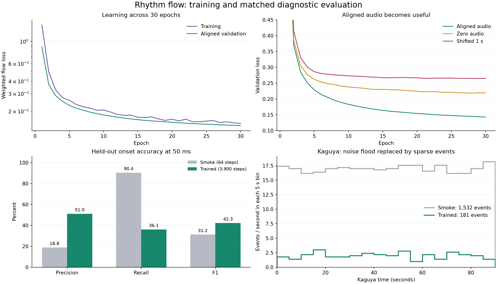

# Rhythm-flow results and Kaguya inference — October 18, 2026

Training job **541156** completed successfully, exit 0, on October 17 at **20:19:31 EDT**. It ran from 19:52:30 for **27m01s**, using four RTX A4000 GPUs. All 30 epochs / 3,900 optimizer steps completed. The retained EMA checkpoint is epoch 30. The first-epoch finish estimate was 20:20–20:30.

This is the independent **rhythm-only conditional flow model**, not a replacement checkpoint for the complete V2 planner + geometry system. It has 602,021 parameters, five output channels, 10 ms frames and 10.24-second training windows. Batch size was 8 per GPU / 32 globally. Each epoch sampled 4,160 source-balanced windows. Training used 260 source groups / 1,100 charts; the complete cache has 330 groups / 1,376 charts. No test data was used to train or select the checkpoint.

The result is a useful timing prototype with demonstrable audio dependence, but its current onset recall, circle classification and hold durations are insufficient to call it a good beatmap generator. It cannot export native geometry or a playable `.osz` yet.

## Training metrics

| Metric | Epoch 1 | Epoch 30 |
| --- | ---: | ---: |
| Training weighted flow loss | 1.462700 | 0.150964 |
| Aligned validation loss | 0.882160 | 0.143064 |
| Zero-audio validation loss | 0.875258 | 0.219379 |
| 1-second-shift validation loss | 0.907836 | 0.265192 |

Training loss decreased 89.7% and aligned validation loss 83.8%. Validation loss continued improving through the final epoch; these curves do not show the earlier V2 planner's immediate validation deterioration. EMA validation versus raw-model training and changing random training windows mean the two curves are not identical estimators. More training could be investigated, but these losses do not establish a convergence or quality guarantee. Peak allocated GPU memory reported by rank zero was 196,660,224 bytes; that excludes other ranks, CUDA context and driver allocations.

## Fresh matched evaluation

Job **549284** completed successfully in 2m02s. Both the 64-step smoke checkpoint and the trained checkpoint were evaluated on exactly the same inputs and random noise: 144 validation windows from 36 source groups, and 136 test windows from 34 untouched source groups. Each window is up to 10.24 seconds. Test windows contain 3,933 reference onsets. Sampling used 32 steps, FP32 generation, paired BF16 flow-loss evaluation, and a 40 ms decoder minimum gap.

Threshold selection maximized validation onset micro F1 at ±50 ms over the predeclared grid 0.2–0.8 in 0.1 steps. Selected thresholds were **0.3 for trained** and **0.8 for smoke**. The smoke optimum is at the tested upper boundary; it is not a claim of a globally optimal threshold. All test thresholds were evaluated for diagnostics, but the selected threshold was fixed from validation only. The common default threshold is also reported below.

Onsets use maximum-cardinality, one-to-one time matching; one prediction cannot explain multiple references. Type-aware scores additionally require the correct circle/slider/spinner type. Occupancy IoU compares thresholded dense hold signals, including holds entering from before a window. This differs from decoded duration accuracy.

| Test metric | Smoke, 64 steps | Trained, 3,900 steps |
| --- | ---: | ---: |
| Onset precision, ±25 ms | 13.81% | 47.45% |
| Onset recall, ±25 ms | 66.26% | 33.54% |
| Onset f1, ±25 ms | 22.85% | 39.30% |
| Onset precision, ±50 ms | 18.85% | 51.04% |
| Onset recall, ±50 ms | 90.44% | 36.08% |
| Onset f1, ±50 ms | 31.19% | 42.28% |
| Onset precision, ±100 ms | 20.59% | 55.86% |
| Onset recall, ±100 ms | 98.80% | 39.49% |
| Onset f1, ±100 ms | 34.08% | 46.27% |
| Circle type + onset precision, ±50 ms | 13.54% | 22.64% |
| Circle type + onset recall, ±50 ms | 43.18% | 8.45% |
| Circle type + onset f1, ±50 ms | 20.62% | 12.31% |
| Slider type + onset precision, ±50 ms | 10.51% | 29.23% |
| Slider type + onset recall, ±50 ms | 41.53% | 34.49% |
| Slider type + onset f1, ±50 ms | 16.77% | 31.64% |
| Spinner type + onset precision, ±50 ms | 0.16% | 0.00% |
| Spinner type + onset recall, ±50 ms | 40.00% | 0.00% |
| Spinner type + onset f1, ±50 ms | 0.31% | 0.00% |
| Slider occupancy IoU | 23.29% | 31.91% |
| Spinner occupancy IoU | 2.56% | 5.49% |
| Macro source onset F1, ±50 ms | 30.46% | 39.41% |
| Object-type accuracy among time matches | 37.39% | 52.92% |
| Matched onset mean absolute error (ms) | 23.41 | 9.79 |
| Matched hold-duration mean absolute error (ms) | 299.85 | 314.94 |
| Matched hold-duration median absolute error (ms) | 194.08 | 165.73 |
| Predicted onsets in test windows | 18872 | 2780 |
| Reference onsets in test windows | 3,933 | 3,933 |
| Predicted events / sampled second | 13.551 | 1.996 |
| Reference events / sampled second | 2.824 | 2.824 |
| Empty test windows | 0 | 0 |
| Default 0.5 threshold onset F1, ±50 ms | 28.40% | 42.16% |

Onset F1 at ±50 ms improved **11.08 percentage points**. A paired bootstrap of the 34 source groups (20,000 resamples, seed 1731) gives a descriptive 95% percentile interval of **+8.54 to +13.44 points**. This assesses sampled-source variation for these fixed checkpoints; it does not include training-seed variation or isolate an architectural effect. The smoke checkpoint is an intentionally undertrained baseline, not the older complete V2 architecture.

The high smoke recall comes from emitting many events and is accompanied by very low precision. Training suppresses that flood and improves F1, while missing about 64% of reference onsets. Circle type-aware recall is only 8.45%; slider type-aware recall is 34.49%; no correctly typed spinner onset was matched. There are only 20 reference spinner onsets, so that category is small.

Circle F1 worsened (20.62% → 12.31%), and matched hold-duration mean error worsened (299.85 → 314.94 ms), despite median error improving (194.08 → 165.73 ms). The matched-event populations differ, so duration changes are descriptive. The decoder also puts a hold end on the last occupied frame, introducing up to approximately 10 ms of endpoint quantization; this cannot explain errors of hundreds of milliseconds. Matched onset error excludes missed/false events and must be read alongside precision/recall.

## Audio dependence

Job **549331** sampled the same test windows with the same initial noise and each model's already selected threshold, changing only the audio input. Aligned generation is reused from the first evaluation.

| Checkpoint / test audio | Flow loss ↓ | Generated onset precision, ±50 ms | Recall | F1 |
| --- | ---: | ---: | ---: | ---: |
| Smoke, aligned | 1.481789 | 18.85% | 90.44% | 31.19% |
| Smoke, zero | 1.466915 | 18.45% | 93.97% | 30.85% |
| Smoke, shifted 1 s | 1.491689 | 18.78% | 90.01% | 31.08% |
| Trained, aligned | 0.149199 | 51.04% | 36.08% | 42.28% |
| Trained, zero | 0.234627 | 28.06% | 8.62% | 13.19% |
| Trained, shifted 1 s | 0.273359 | 32.88% | 23.29% | 27.27% |

For the trained model, zeroing audio raises flow loss 57.3%, and shifting it raises loss 83.2%. Generated onset F1 drops from 42.28% to 13.19% without audio or 27.27% with shifted audio. This is evidence that correct audio correspondence helps generation, rather than only reducing a training objective. The smoke model barely benefits from alignment. Zero audio is an out-of-distribution input, and the 1-second intervention wraps within each window; these are diagnostics, not complete causal or musical-quality proofs.

## Kaguya inference

All inference used the exact original 90.149625-second Kaguya MP3, target profile 4.5, 32 sampling steps, and identical seeds for smoke/trained comparisons. Outputs contain 9,015 frames and five signals. The 4.5 setting is a conditioning input: **realized osu! stars cannot be calculated without object positions and slider geometry**. There is no aligned human reference for this particular Kaguya export in the evaluation, so no Kaguya-specific onset precision/F1 is claimed.

| Seed, default threshold 0.5 | Smoke events | Trained events | Trained circles / sliders / spinners | Last trained event end |
| --- | ---: | ---: | --- | ---: |
| 1731 | 1532 | 181 | 33 / 148 / 0 | 88.60 s |
| 1732 | 1520 | 221 | 71 / 150 / 0 | 88.45 s |
| 1733 | 1508 | 181 | 43 / 138 / 0 | 88.92 s |

The primary **validation-calibrated** export (seed 1731, threshold 0.3) contains **182 events: 33 circles, 149 sliders, no spinners**. Its first event is at 0.55 s and final hold ends at 88.60 s, leaving 1.55 s at the end. The largest onset gap is 1.94 s. Its density is 2.02 events/s. No decoded slider has zero duration; the matched default smoke sample has 526 zero-duration holds and 1,532 events (~17/s). This is a substantial reduction in obviously noisy output, but fewer events are not automatically better and slider prevalence is suspicious.

These samples span the song and do not exhibit the old original Kaguya map's missing ending. The already repaired V2 Kaguya also covered the song, so coverage is not evidence this prototype beats that repaired system. The rhythm sampler has no EOS token but can still produce empty regions; tensor length alone is not an event-coverage metric.

Primary iLab event export:

```text
/common/users/asj102/osu_project/v2_runs/run_20261017_rhythm_training/evaluation_20261018/kaguya-trained-1731-calibrated-events.json
```

Companion raw signal tensor: `kaguya-trained-1731-rhythm.pt` in the same directory. JSON and signal files are diagnostic artifacts, not importable `.osz` archives. Connecting these millisecond plans to V2 requires a timing representation and valid planner-conditioning states, followed by geometry retraining/testing on this new distribution. No such integration was silently substituted for the requested new-model inference.

## What to improve next

1. Inspect onset/type and hold loss components and class frequencies; test separate onset/type supervision and stronger circle/spinner examples. The current total loss can improve while circle recall remains poor.
2. Separate sparse onset decoding from hold occupancy. Correct hold endpoints and type decisions, then choose thresholds and minimum gaps on validation; never tune on Kaguya or test results and call those held-out metrics.
3. Run a controlled longer-training pilot because validation is still improving, with generated precision/recall, per-type scores and audio controls as acceptance criteria. More epochs alone do not resolve a biased decoder or representation.
4. Evaluate full held-out songs, more generation seeds, silence behavior, rhythm selection and difficulty dependence. The present 136 windows may overlap and are not 136 independent songs. One human map is one acceptable interpretation; chart-match recall is not identical to listener judgment.
5. Only after timing is acceptable, integrate native geometry, evaluate realized stars and rendered paths, and playtest complete maps. The old V2 token accuracy and geometry diffusion loss are different metrics and cannot be compared numerically to this flow loss/F1 as proof of overall superiority.



## Reproducibility and artifacts

- Training source commit: `3866dea34f3e8f4c4f6dab19ecc5d0342d485871`.
- Trained checkpoint SHA-256: `a15939c214122590dca981994727f9f283fcc8a5668569503440a717af67b1e5`.
- Training manifest SHA-256: `c90ed4044a6d4b053f5ffb4a73276fd023ac38e4f6ae2c305fd37de20b3bbb32`.
- Checkpoint: `/common/users/asj102/osu_project/v2_runs/run_20261017_rhythm_training/train/best.pt`.
- First evaluation source: `/common/users/asj102/osu_project/codex_rhythm_evaluation_20261018`; generation controls: `/common/users/asj102/osu_project/codex_rhythm_controls_20261018`.
- Remote outputs: `/common/users/asj102/osu_project/v2_runs/run_20261017_rhythm_training/evaluation_20261018`.
- Local raw metrics, per-source counts, threshold grids, event exports and training history: [`docs/evidence/rhythm-flow-2026-10-18/`](evidence/rhythm-flow-2026-10-18/).
- Evaluation implementation: [`scripts/evaluate_rhythm_flow.py`](../scripts/evaluate_rhythm_flow.py). Tests check exact onset/occupancy metrics, missing-event behavior, one-to-one matching, and matcher cardinality against exhaustive matching on 100 small random cases. All four tests passed.
- Historical checkpoints and prior outputs were preserved. GPU work used Slurm; no full training was started by this evaluation.
