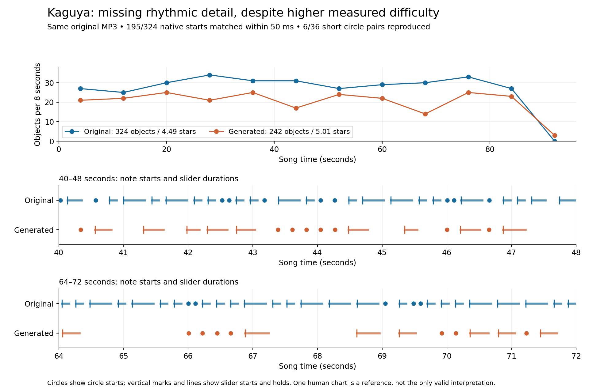

# Rhythm follow-up: original Kaguya comparison

The user's playtest identified missing objects at important musical moments,
incorrect timing/sound choices, and missing short two-note patterns. Placement is
also below the target. The generated-map evidence supports this critique despite
the substantial improvement over the older rhythm-only model in short windows.

## Exact-audio comparison

Original remote archive: `/common/users/asj102/osu_project/1147361 Suzuki Masayuki
- DADDY ! DADDY ! DO ! feat. Suzuki Airi (TV Size) [no video].osz`.
The previous inference MP3 differed from this archive's MP3: 90.149625 versus
92.4 seconds, with a constant -254.1667ms shift. Four independent 4-second waveform
checks at 10/30/60/80s gave correlations 0.9807–0.9866 at that shift. The comparison
therefore regenerated from the exact original bytes, rather than treating an
encoding/trim offset as model error.

Ran 16 seeds at requested 4.5 stars; all exceeded the default ±.5-star tolerance.
Seed 1737 was closest, at 5.01448 stars. Reproduced that seed with an explicitly
diagnostic ±.6 tolerance to save its native map. This relaxation is recorded and
does not establish successful difficulty control. The original closest to the
request is `Confession?`, measured 4.48741 stars by rosu-pp-py 4.0.2.

| Measure | Original | Generated |
| --- | ---: | ---: |
| Total objects | 324 | 242 |
| Circles | 85 | 122 |
| Sliders | 239 | 120 |
| Median start gap | 218ms | 230ms |
| Gaps under 150ms | 40 | 25 |
| Median slider duration | 108.70ms | 260.68ms |
| Measured stars | 4.487 | 5.014 |

195/324 original starts match within 50ms: 60.19% recall and 80.58% precision.
129 native starts are missing and 47 generated starts are unmatched under this
definition. At 10ms there are 135 matches. Among 50ms matches, absolute error is
8.63ms, with a +6.07ms mean signed error. These conditional errors exclude missing
and extra notes; they must not be presented as the whole rhythm error.

There are 36 consecutive original circle pairs with positive gaps at most .51
native beats. Only 10 retain both generated starts within 50ms, and only 6 retain
both as circles. Overlapping pairs are counted; this diagnostic is not a claim
that every user use of “double click” means this exact pattern.

The 40–48s segment has 31 reference starts versus 17 generated, with 19 reference
starts unmatched; 64–72s has 30 versus 14. Other valid musical interpretations
are possible, so exact reference reproduction is a diagnostic rather than the
sole quality objective.

Raw comparison and event timelines are in
`docs/evidence/audio-native-flow-2026-10-25/kaguya-diagnostic/`.
The reference encoded audio was absent from the original training cache; this
checks exact identity, not every possible alternative encoding. Kaguya is now an
explicit development example regardless of its prior training status.

## Independent full-song baseline

Twelve original frozen validation sources, two seeds each (92731/92732), same
checkpoint, fixed threshold .5, 48 integration steps. For each source, select the
chart nearest 4.5 stars before seeing any generated output; use that chart's
profile. References and inputs are unchanged across the upcoming models.

* 50ms onset F1: 59.51%; precision 57.54%, recall 61.62%.
* Short-circle pairs: 908/3318 have both starts; 621/3318 (18.72%) have both circles.
* Duration MAE on matched same-type holds: 120.00ms, median 71.64ms.
* Generated density 2.643 events/s versus reference 2.468 events/s.
* Spinner recovery remains zero on these references.

Counts pool two generation seeds, including repeated reference instances. This
confirms that a blanket density increase is not the solution: local sound choices,
pattern consistency and marks must improve. Evidence:
`docs/evidence/audio-native-flow-2026-10-25/original-full-song-validation/metrics.json`.

## Changes under evaluation

1. Expand authentic audio/native charts from the pinned corpus, preserving frozen
   source splits and hashes. Scan the next 1,000 records with a 4GiB feature budget.
   The previous 260 independent training sources and large train/validation gap
   make more epochs on the same small corpus an inadequate next experiment.
2. Add two masked audio Transformer layers over 80ms pooled features inside the
   20.48s window, while preserving the original 10ms convolution path. The output
   projection initializes at zero so existing weights transfer without initially
   disturbing the learned audio path. This is 20.48s context, not a proven
   whole-song motif planner or pretrained instrument understanding.
3. Add an audio-only auxiliary head for native event density in 1.28s regions.
   It regresses log(1+events/s), weighted .1; onset flow MSE remains unweighted.
   This supervises local changes in density without forcing extra events into
   every song. The new architecture has 2,432,519 parameters.
4. Compare old architecture and revised architecture on the same expanded data,
   initial checkpoint, 20-epoch budget, 1e-4 learning rate and validation references.
   This separates data expansion from the combined context/density change; it
   does not isolate context from the auxiliary objective or training-seed effects.

The new model passed 25 focused onset/export/timing tests and a 64-update GPU
smoke. Full training is queued behind corpus expansion. No measured musicality
improvement from these changes is claimed yet.

Broader regression job 814915 passed **74 tests** covering both new models,
generation, clock fitting, native timing/maps, audio clocks, quality checks,
grammar and historical rhythm data/splits. Two non-failing warnings remain:
scalar conversion in a test assertion and a pre-existing attention-mask dtype
deprecation. Pytest was installed into the isolated overlay, not the training env.

## Clock diagnostic

[Beat This!](https://github.com/CPJKU/beat_this) 1.1.0, `final0` checkpoint SHA256
`8c328b45f59d8dd3dff219253ff6a8d6482be57d0133a29140e2febbf8eb8331`, runs in an
isolated dependency overlay; the established training environment was not changed.
Detected beats are fitted with global phase coherence and robust regression.
The first naive median-interval fit incorrectly accumulated the tracker's 20ms
quantization and was rejected. The corrected fitter passes quantization/missing-
beat and variable-tempo tests, and estimates Kaguya at 138.0034 BPM versus its native
138 BPM. The old autocorrelation gives 138.4546 BPM.

The tracker's fitted beat phase is about 28ms later than the reference clock, so
correct BPM alone does not justify snapping gameplay to it. This remains a
diagnostic, not an automatically enabled timing repair. See original and refitted
reports under `kaguya-diagnostic/`; preserve both for provenance.

## Operational continuation

Run root: `/common/users/asj102/osu_project/flow_runs/run_20261025`.
Source: `codex_audio_flow_20261025_expanded_train`.
Jobs: expansion 814768; control 814837; phrase model 814838; completed full-song
baseline 814839. The two training jobs depend on successful expansion and each
automatically evaluates validation windows and the frozen full-song set.

Before choosing a replacement, inspect validation precision/recall and phrase
counts, short-pair recovery, types and duration; then regenerate Kaguya. Preserve
original checkpoints and maps. Difficulty/geometry coordination, multimodal
duration choices, spinner behavior, sound/instrument representation and human
playtesting remain outstanding. Automated validity or F1 does not establish
professional-quality mapping.
