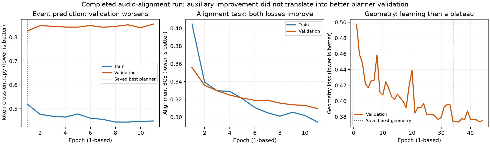

# Completed V2 audio-alignment model: architecture and measured results

The new model improves teacher-forced event prediction and produced a Kaguya
candidate close to 4.5 stars. It has not demonstrated stronger dependence on
audio, and fine residual timing plus stochastic geometry proxies worsened.
This is an incremental improvement with unresolved musicality and control issues.

## Evaluation and comparison scope

- Baseline: `run_20261014_real/geometry/best.pt`, revision
  `checkpoint-43200-a991a335083180d0`.
- Audio-alignment model: `run_20261015_audio_alignment_precision/geometry/best.pt`,
  revision `checkpoint-40800-7d980e615f1a5ca3`.
- Same corpus: 773 charts, 188 independent audio components; 150 train / 20 val /
  18 test. These are not 773 independent songs.
- Full test: **6,818 bars, 225,451 tokens, all 18 test components**. Same evaluator,
  batch size four and seed 1001340. The new evaluation's loader uses spawn rather
  than fork; this changes worker startup, not the evaluation definition.
- Audio interventions: **80 identical validation bars, 20 components, 2,676
  tokens**, seed 1731. Sample-index equality was explicitly checked.
- Read-only jobs 531823 (full test) and 531825 (audio audit) completed successfully.
  They did not change weights or select a new checkpoint.

The test supplies correct current-token prefixes, previous-bar tokens and human
timing maps. Geometry receives human event plans. These are conditional prediction
measurements, not autonomous full-song accuracy or human judgments. The two runs
also differ in initialization/training schedules and hardware; this is a comparison
of completed systems, not an isolated causal ablation of architecture alone.

## Architecture changes

| Component | Previous V2 | Audio-alignment V2 |
| --- | --- | --- |
| Overall structure | Hierarchical event planner, then geometry diffusion | Same two stages |
| Decoder audio memory | One contextual vector sampled near each bar midpoint | Global bar vectors plus 128 individually addressable audio vectors for the current bar |
| Local vectors | Detailed encoder frames not exposed separately to decoder | Learned rhythm frames fused with original rhythm features, position and bar/profile context |
| Planner supervision | Next-token cross-entropy | Next-token CE + 0.2 × alignment BCE |
| Auxiliary predictions | None | Circle, slider and spinner onsets; slider-active interval |
| Geometry network | Diffuser predicting positions/slider geometry | Same network structure, retrained against updated planner representations |
| Capacity | About 113.59M parameters total | About 113.96M: roughly 0.38M extra, about 0.33% |

The 128 vectors are learned feature tokens, not 128 notes. Beat-space query
positions are converted individually to milliseconds, including within-bar tempo
changes. A two-second bar has approximately 15.6 ms query spacing; this is not an
accuracy guarantee. Both training and autoregressive generation use this path.

Alignment labels describe a human mapper's selected events at a difficulty, not
every acoustic attack or the identity of an instrument. Labels are training
targets only. The auxiliary head is not a hard gate forcing generated notes.
Both models still use mixed-song rhythm/mel features and pooled mel context.
Instrument separation and pretrained transcription/music encoders were not added.

Operational corrections included spawned loader workers, float64 query clocks
for extremely short meter-transition bars, and quota-aware checkpoint retention.
Clock precision does not change the entire neural network to float64. The complete
V2 test suite passed 109 tests and 28 subtests before the production run.

## Full held-out test metrics

Higher accuracy is better; lower CE/perplexity/loss is better.

| Metric | Previous | New | Change |
| --- | ---: | ---: | ---: |
| Overall token accuracy | 71.72% | 72.89% | +1.17 percentage points |
| Coarse within-bar offset accuracy | 65.49% | 67.79% | +2.30 pp |
| Snap/subdivision accuracy | 94.89% | 97.76% | +2.87 pp |
| Fine residual-timing accuracy | 23.74% | 23.11% | -0.62 pp |
| Object-kind accuracy | 64.71% | 65.95% | +1.24 pp |
| Slider-curve-type accuracy | 55.30% | 59.24% | +3.93 pp |
| Duration-token accuracy | 56.36% | 56.27% | -0.08 pp |
| Token-weighted CE | 0.80696 | 0.76673 | About 5.0% lower |
| Token perplexity | 2.2411 | 2.1527 | Lower |
| Geometry loss proxy | 0.35922 | 0.37275 | 3.8% higher |
| Slider-shape loss component | 0.09092 | 0.10294 | 13.2% higher |

Token accuracy improved on **15 of 18 test audio components**. A paired
source-component bootstrap (20,000 resamples, seed 1731) estimates a 95% percentile
interval of **+0.49 to +1.99 percentage points** for the token-weighted accuracy
difference. CE's interval is -0.0727 to -0.0147. These describe uncertainty over
this small test set, not variation across retraining seeds or a proof that the
architectural change alone caused the gains.

The geometry numbers are descriptive stochastic proxies. The evaluator seeds RNG
before model construction; adding modules consumes a different number of random
draws, so old/new diffusion noise is not exactly paired. Confirm small differences
with explicitly shared diffusion noise before treating them as definitive. These
losses also do not measure movement comfort. Predicting a curve type correctly
does not establish that its sampled control points form a good slider.

## Audio grounding remains unproven

Same 80 validation bars and reference histories in every condition:

| Input condition | Old token accuracy | New token accuracy |
| --- | ---: | ---: |
| Aligned audio | 70.03% | 70.67% |
| Shifted approximately 137 ms | 69.62% | 70.44% |
| Shifted approximately 997 ms | 69.51% | 70.59% |
| Zeroed audio features | 69.51% | 70.78% |
| Previous-bar history removed | 67.53% | 68.95% |

For the new model, aligned versus zero-audio coarse-offset accuracy is 60.98%
versus 60.63%: only one correctly predicted offset token out of 287 differs.
The aligned-audio CE is 0.90123 versus 0.90572 with zero features, a small change.
The new architecture supplies an audio path, but these results do not show a
stronger useful dependence on it. Correct prefixes and clocks remain strong cues.
Zeroed features are an out-of-distribution intervention, shifts wrap at stream
boundaries, and this experiment is small; it does not prove that audio never
matters. Next tests should include wrong-song audio and free-running generation.

## What the training curves show

The run completed in 9:21:38, with 11 planner epochs and 44 geometry epochs.
The retained planner is **epoch 1**; retained geometry is **epoch 34**, using
one-based numbering. Later geometry losses can be numerically slightly lower
without clearing the configured 0.001 minimum-improvement threshold.

| New planner metric | Epoch 1 | Epoch 11 | Interpretation |
| --- | ---: | ---: | --- |
| Train token CE | 0.51842 | 0.44859 | Fits training prefixes better |
| Validation token CE | 0.82637 | 0.85473 | Event prediction generalization worsens |
| Validation alignment BCE | 0.35568 | 0.30948 | Auxiliary task improves |
| Combined validation loss | 0.89751 | 0.91663 | Overall checkpoint criterion worsens |

This pattern is consistent with overfitting and/or competing training objectives;
it does not identify one unique cause. The improved epoch-11 auxiliary head is
not the planner used in the delivered map: checkpoint selection retained epoch 1.
The head can also exploit clock/profile/positional priors, and BCE can improve
without good onset recall. Report onset precision/recall/F1 and precision-recall
area, including sparse-event baselines, before calling the head musically better.

## Kaguya selected-output comparison

Both outputs target 4.5 stars, using the same pinned stable/no-mod calculator.

| Metric | Previous delivered map | New delivered map |
| --- | ---: | ---: |
| Measured stars | 6.4518 | 4.4732 |
| Absolute target error | 1.9518 | 0.0268 |
| Objects | 218 | 99 |
| Sliders | 43 | 30 |
| Minimum start gap | 11 ms | 73 ms |
| Mean head-to-head distance | 179 px | 221 px |
| Maximum head-to-head speed | 30,944 px/s | 5,944 px/s |

The new delivered result hits the requested difficulty much more closely and has
less extreme rapid movement. It is also much sparser and has longer average jumps;
neither fewer notes nor a lower star error establishes better musical coverage.
The remaining peak movement speed is still a playability concern to inspect.

Old Kaguya used four candidates, seeds 100–103. New generation used eight
candidates, seeds 1500–1507, then two tighter-search candidates, seeds 1600–1601.
Both selected maps use the audio estimator's half-tempo clock, approximately
69.2 BPM. The new search omitted the double-tempo alternatives after they
overshot 10 stars. Different seeds and search budgets confound attribution to
architecture. The 4.4732-star map is a native sampled candidate, with 99 sampled
objects; event thinning or geometric rescaling was not used.

The final archive passed CRC, parsing, structural checks and original-audio hash
matching. No osu! client playtest or new matched held-out full-song onset-F1
benchmark has been performed. Earlier three-song F1 measurements belong only to
the baseline and must not be presented as new-model results.

## Training cost and next priorities

| Observed run characteristic | Previous | New |
| --- | ---: | ---: |
| GPUs | 4 A4500 | 5 RTX 4500 Ada |
| Effective global batch | 16 | 20 |
| Mean planner epoch | 239 s | 739 s |
| Mean geometry epoch | 221 s | 575 s |
| Total run | 9h05m23s | 9h21m38s |

This is not a controlled hardware-speed comparison. Nevertheless, the new run
consumed more resources despite completing far fewer epochs. A small CPU profile
spent 14.51 of 16.21 seconds reconstructing chart reference events. Cache these
immutable alignment events with content/version keys, then tune loading workers
and remeasure. More GPU compute alone will not remove this repeated CPU work.
[PyTorch's data-loading guidance](https://docs.pytorch.org/tutorials/recipes/recipes/tuning_guide)
supports measuring and tuning that pipeline.

Recommended experiments, not claimed results:

1. **Fix transfer/training stability.** Warm up the new audio projection/head
   with the old backbone frozen, then unfreeze at lower LR; compare auxiliary
   weights and local-token budgets. Run baseline / local-tokens-only /
   local-tokens-plus-head ablations with equal seeds, data, optimizer steps and
   generation budgets. Select checkpoints using validation criteria that include
   free-running behavior and audio dependence, not BCE alone.
2. **Measure useful audio grounding.** Add onset F1/PR curves and wrong-song or
   shifted-audio controls, keeping history/clocks fixed. Consider an objective
   that rewards correct audio-event correspondence over mismatched audio;
   simply increasing the auxiliary weight could worsen event prediction.
3. **Reduce the timing input mismatch.** Records currently reject non-oracle
   clocks until variant-specific targets are reprojected correctly. Build those
   targets and compare an audio beat/downbeat model such as
   [Beat This!](https://github.com/CPJKU/beat_this). A better clock can improve
   timing but will not independently solve excessive spacing or difficulty.
4. **Improve controllability and movement.** Evaluate matched free-running
   held-out songs with fixed candidate budgets, star-error distributions, onset
   matching, density/coverage and extreme-jump statistics. Improve conditional
   difficulty/density learning and movement-aware reranking, while retaining
   mapper choice; a single 4.5-star success is insufficient.
5. **Improve data and feature quality after removing the CPU bottleneck.** Add
   independent songs and balanced difficulty coverage; keep validation for tuning
   and test for final evaluation. Compare a frozen pretrained onset/transcription
   encoder or music representation such as [MERT](https://arxiv.org/abs/2306.00107)
   in a separate versioned feature pipeline. Both extraction and clocks must be
   consistent at training and inference. Benefits to this model remain untested.

Raw evidence is in the adjacent `v2-test-metrics-2026-10-16.json`,
`v2-audio-dependence-2026-10-16.json`,
`v2-architecture-comparison-statistics-2026-10-16.json`,
`v2-audio-alignment-training-final-2026-10-16.json` and
`v2-kaguya-inference-2026-10-15.json` files.
