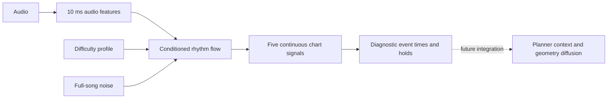

# Kaguya coverage repair and rhythm diffusion research — October 17, 2026

The new Kaguya archive fixes the missing second half and passes a rendered-slider
boundary check after export and re-import. Musical timing remains unresolved.
A separate rhythm flow-matching experiment is implemented and GPU-tested; it is
not yet a replacement for the trained V2 planner or a complete native map generator.

Work is on `codex/v2-coverage-rhythm-flow`, branched from `d75f6a8`. That baseline
was already committed and pushed before these edits. Historical datasets,
checkpoints and deployments were preserved.

## What was wrong with the played map

I downloaded the exact October 15 archive and replayed its original source and
checkpoint on iLab. Its audio is 90.149625 seconds long. The replay reproduced
99 events and the missing ending: bar 0 was empty, bars 1–14 contained events,
and bars 15–25 were all empty. The planner processed the entire timeline; it did
not stop reading the file at 46 seconds. Autoregressive generation entered an
empty-bar sequence around 52 seconds and never recovered.

The old candidate selection checked difficulty and object structure, but did
not reject large unmapped audible sections. A short map could therefore win by
being close to the requested stars. The reported 46 seconds was the interval
between the first and last object, not the audio file's duration.

| Measurement | Played archive | Repaired archive, after native round-trip |
| --- | ---: | ---: |
| Audio duration | 90.150 s | 90.150 s |
| First object | 5.409 s | 0.210 s |
| Last object end | 52.205 s | 86.869 s |
| First-to-last playable span | 46.796 s | 86.659 s |
| Objects / sliders | 99 / 30 | 164 / 56 |
| Realized difficulty, rosu stable/no mods | 4.473 stars | 4.093 stars |
| Unmapped audible ending | 36.795 s | 2.131 s |
| Energy-based coverage diagnostic | 59.3% | 100% |
| Slider bodies outside the audited playfield | 16 | 0 |

The 100% figure means audible regions are within three seconds of an object or
hold. It does **not** mean every musical beat is mapped correctly. The repaired
chart leaves about 3.28 seconds of physical audio after the final object, including
the fade. Its 4.09-star rating is within the existing ±0.5-star acceptance window
around 4.5, rather than exactly 4.5.

## Inference and slider fixes

- When an audible bar samples no objects, generation retries up to twice using
  the planner's existing previous-bar-dropout path. This breaks dependence on
  an empty previous bar without inventing notes. Truly silent bars are exempt.
- Selection now requires at least 85% coverage of audible regions and rejects
  more than five seconds of unmapped audible introduction or ending. These are
  configurable generation safeguards, not universal rules for human mapping.
- The final bar ends at the actual audio boundary. Holds extending past the file
  are capped there, with slider length updated consistently.
- Slider validation evaluates the curved path and native pixel-length trimming
  or extension. Checking the head and anchors alone was insufficient: one old
  Bezier slider extended to approximately x=638 despite the playfield ending
  at x=512. osu!'s own path implementation explains why requested path length
  can extend a curve beyond its final control point.
  [Native SliderPath implementation](https://github.com/ppy/osu/blob/master/osu.Game/Rulesets/Objects/SliderPath.cs).
- A fitting operation translates an entire object/curve inside the playfield,
  including its CS-dependent radius and a two-pixel buffer. It preserves the
  curve type, relative control points, length, repeats and timing. Oversized
  curves remain explicit audit failures; they are not silently flattened or
  discarded to lower difficulty.

The numerical L/B/P/C path evaluator is an approximation, not a bit-for-bit osu!
client implementation. It does not simulate stacking. The final serialized map
was parsed and audited again, but I have not visually playtested it in the client.
Moving objects can alter surrounding jumps; one head-to-head speed proxy still
reaches roughly 13,578 px/s. That proxy is not the official aim difficulty formula,
but it is another reason not to declare the resulting map human-quality.

The matched generation used unchanged trained weights, 32 geometry steps,
temperature 0.9, and the prior base/half-tempo search. Five repair candidates were
examined; `repair-04`, seed 1605, was the first passing coverage, geometry and star
checks. Other candidates had unsuitable difficulty. A no-retry control in this
new-source experiment already included the partial-final-bar fix and is not the
exact historical baseline. The separate old-source replay is the baseline proof.

## What osu!dreamer contributes

I inspected upstream commit `47e65d9f52e6bfc452a13ea2f734ccdcaa7d8f06`, not just its
project description. It represents maps as dense audio-aligned signals, compresses
them through a learned latent model, generates conditioned latents, and decodes
back into map signals. Its workflow includes latent, denoising and style stages.
This jointly models timing and cursor information rather than delegating only
geometry to diffusion. [osu!dreamer](https://github.com/jaswon/osu-dreamer).

The pinned encoder uses nine chart channels, including event/hold information,
hitsounds and cursor X/Y. Audio frames are approximately 6 ms apart. Latent time
is downsampled by 27. This gives the generator a continuous timeline without an
end-of-sequence token deciding whether the rest of the song exists.
[Signal encoder](https://github.com/jaswon/osu-dreamer/blob/47e65d9f52e6bfc452a13ea2f734ccdcaa7d8f06/osu_dreamer/data/beatmap/encode.py),
[audio loader](https://github.com/jaswon/osu-dreamer/blob/47e65d9f52e6bfc452a13ea2f734ccdcaa7d8f06/osu_dreamer/data/load_audio.py).

A technical distinction: the current upstream denoiser is a distance-marching
field. It predicts a distance and direction and repeatedly moves noise toward
the learned data manifold. It is not simply a conventional DDPM noise predictor.
Our new experiment uses time-conditioned conditional flow matching with a linear
noise-to-data path; it does not reproduce that upstream implementation.
[Pinned denoiser](https://github.com/jaswon/osu-dreamer/blob/47e65d9f52e6bfc452a13ea2f734ccdcaa7d8f06/osu_dreamer/models/diffusion/model.py),
[Flow Matching paper](https://arxiv.org/abs/2210.02747).

| Approach | Useful properties | Costs and risks | Decision |
| --- | --- | --- | --- |
| Existing V2 sparse planner + geometry diffusion | Trained weights, native curve representation, explicit difficulty controls | Teacher-forced chart history and oracle timing during training differ from generation; empty-bar collapse; weak measured audio reliance | Keep, fix coverage and native-path validation |
| Full osu!dreamer-style latent chart generation | Joint timing/position modeling, dense audio correspondence, no autoregressive stop token | New latent codec, style model and decoder; several training stages; possible curve reconstruction losses; does not guarantee musical selection or calibrated stars | Valuable longer-term comparison, not an immediate replacement |
| New rhythm-only conditional flow | Direct audio-time supervision, no chart prefix or oracle beat grid, bounded full-song sampling, inexpensive experiment | Sparse peaks can be noisy; thresholding matters; no geometry yet; needs convergence and held-out evidence | Implement as a separate experiment and test timing first |
| Stronger sparse audio-event model | Retains native discrete events and could use pretrained audio features | Still needs careful clock/context treatment and enough songs | Keep as a competing baseline |

Mapperatorinator provides another useful reference: its sparse-event system uses
an audio-conditioned architecture, overlapping inference windows and timestamp
jitter during training. Its dataset link points to the same project-riz corpus
we already use, so it is not an independent second dataset to concatenate.
[Mapperatorinator](https://github.com/OliBomby/Mapperatorinator).

OliBomby's osu-diffusion focuses on geometry conditional on map structure. It is
closer to our existing second stage and cannot by itself repair wrong event times.
[osu-diffusion](https://github.com/OliBomby/osu-diffusion).

## What was implemented for rhythm flow

`src/rhythm_flow/` is independent of the production V2 checkpoint format. It uses
the existing 101-dimensional audio features at 10 ms resolution, difficulty/profile
conditioning, and five chart signals: circle, slider and spinner onsets, plus
slider and spinner occupancy. It learns a vector field from Gaussian noise to
human chart signals. A fixed event-weighted loss emphasizes sparse positives;
empty windows remain training examples. This weighting is an experimental choice,
not a claim of an exact unweighted flow-matching distribution objective.

Training still compares a numerical prediction with a target derived from a human
map. Here the residual is the predicted noise-to-chart velocity minus the target
velocity, rather than a deterministic guess of the one correct map. Noise
conditioning permits different sampled layouts; diffusion does not make ambiguity
or data quality disappear. Ordinary denoising MSE is not inherently incompatible
with learning multiple valid maps.



The initial network has 602,021 parameters: ten dilated convolution blocks of
width 96. Training uses 10.24-second windows, source-balanced sampling, mixed
precision, gradient clipping and EMA. The trainer supports torchrun/DDP, although
the completed smoke run used one GPU. It records source-manifest hashes and runs
paired aligned/zero-audio/one-second-shifted-audio validation with identical noise.

Sampling uses one noise tensor for the whole song. At each ODE step it blends
predictions from overlapping windows, including the final partial window. The
signal length must equal the audio feature length. This prevents truncation via
EOS, but the model can still produce an empty or musically poor region.

A diagnostic peak decoder emits event times and holds. It does **not** produce
native slider geometry or an `.osz`. Connecting it to the existing geometry model
would require converting its millisecond event plans to a timing hypothesis and
valid planner-conditioning states, followed by testing or retraining geometry on
that distribution. That integration was deliberately not represented as complete.

### Completed GPU smoke result

Job `537483` completed successfully. Data conversion plus training/sampling took
9m12s; the 64 optimizer steps and validation took about 21.3 seconds. Peak allocated
GPU memory was 190,252,544 bytes. Validation covered 32 windows:

| Loss, lower is better | Value |
| --- | ---: |
| Training | 1.78224 |
| Aligned audio validation | 1.47253 |
| Zero audio validation | 1.46058 |
| Audio shifted by 1 s | 1.49343 |

The eight-step Kaguya sample had 9,015 frames covering the entire 90.15-second
recording, but decoded 1,533 events. Zero-audio loss being slightly better is no
evidence of useful musical conditioning. This checkpoint is a pipeline smoke
artifact and should not be used as a playable map model. Full training is prepared
in `configs/rhythm_flow_train.sbatch` but has not been submitted as a quality run.

## Is the timing problem representation or data?

There is evidence for multiple problems, not a single established cause:

1. The previous completed comparison used only 188 independent audio components
   (150 train), despite 773 difficulty charts. More charts for one song do not
   provide the diversity of new songs.
2. Previous paired validation showed token accuracy 70.67% with audio versus
   70.78% with zeroed audio. The audio path exists, but the model can rely heavily
   on chart history and the supplied timing map. This does not prove audio has
   literally no effect; it does weaken claims of reliable audio-driven timing.
3. Fine residual timing accuracy declined slightly, while coarse event accuracy
   improved. Validation selected the planner's first epoch, and training improved
   after validation worsened. More epochs alone were not a demonstrated solution.
4. Human timing maps during training versus estimated clocks at inference are a
   distribution mismatch. Feeding altered clocks without reprojecting targets
   would create wrong labels. The flow experiment avoids this particular dependency.

See [the prior measured comparison](v2-architecture-comparison-2026-10-16.md).

The earlier idea of exposing musical parts is still useful. Current features
include spectral and band-attack information; they are not original FL Studio
tracks, instrument labels, MIDI or separated stems. An exported song does not
contain recoverable ground-truth DAW tracks. Learned separation could provide
additional cues, but it introduces errors and compute/storage costs. It should be
an ablation once an audio-dependent timing baseline is established, not a claim
that decomposition alone supplies mapper intent.

## Data acquisition and storage

The existing 773 records were converted to shared half-precision audio tensors
plus small chart/event manifests: 188 audio files, 679,807,200 bytes of audio cache.
This is a rhythm-flow cache, not a replacement set of V2 geometry training records.
Existing V2 checkpoints have not been retrained on the added songs.
Multiple corpora can enter this converter, but incompatible feature pipelines or
conflicting split assignments are rejected. Existing labels retain their prior
codec quantization, which is explicitly recorded.

For expansion, the acquisition script streams original audio from project-riz at
immutable revision `b82117a5de13b7df5290482aed7cffc49cb76e6d`, skips the first 300
tracks already scanned previously, and scans 200 more. It selects ranked/approved
standard maps, verifies encoded hashes, measures difficulty, checks chart times
against audio duration, and extracts native millisecond labels. Canonical audio
and transitive source identities prevent duplicate or related songs leaking across
splits when they share those identities. No new acoustic near-duplicate detector
was added; alternate encodes with different PCM hashes can require further review.
Existing split assignments remain frozen; a new source linking old train
and held-out groups causes a merge rejection.

The public dataset describes 46,386 audio tracks and 213,068 maps across modes and
statuses; those are not counts of eligible standard ranked training examples.
Growing our verified subset is more useful now than counting the same corpus twice.
[Dataset card](https://huggingface.co/datasets/project-riz/osu-beatmaps).

osu2mir supplies beat/downbeat annotations for a much smaller collection, useful
for future clock evaluation. It is not a replacement for native difficulty charts
and does not bundle the corresponding audio.
[osu2mir](https://github.com/ziyunliu4444/osu2mir).

New feature storage is capped at 768 MiB. Existing cache files are hardlinked,
raw downloaded audio is temporary, and historical records are untouched. The first
expansion job `537485` failed at an undecodable audio file after processing 195
tracks. Error handling now records and skips such audio; an incremental acquisition
journal preserves progress but cannot be used as a training manifest. The retry
uses a fresh `expanded-cache-v2` directory under job `540165`.

The retry completed successfully in **13m49s**. It added **603 charts and 142 audio
sources**, producing **1,376 charts / 330 source groups**: **260 train, 36 validation,
34 test**. New feature files occupy **528,388,048 bytes** (about 504 MiB), under the
768 MiB cap. Combined audio feature storage is **1,208,195,248 bytes**, shared across
all difficulties. This is a useful increase from 150 to 260 training sources,
but still a pilot subset rather than a large, proven generalization corpus.

The verified cache is `run_20261017_coverage/expanded-cache-v2`. The interrupted
`expanded-cache` directory is preserved for diagnostics and has no finalized
training manifest; do not use it for training.

Post-run verification passed all **330 audio file SHA-256 checks**, preserved all
**773 historical chart split assignments**, and loaded valid finite training,
validation and test tensors. Chart counts are 1,100 train / 153 validation / 123
test. Two records were rejected in total, including the one undecodable audio
source. The merged manifest SHA-256 is
`c90ed4044a6d4b053f5ffb4a73276fd023ac38e4f6ae2c305fd37de20b3bbb32`.
[Machine-readable cache audit](evidence/v2-coverage-2026-10-17/expanded-cache-audit.json).

Compact generation, historical replay and GPU smoke evidence is retained in
[`docs/evidence/v2-coverage-2026-10-17/`](evidence/v2-coverage-2026-10-17/).

## Validation and operational record

- `537478`: repaired generation, completed, 2m00s. Original audio bytes preserved.
- `537486`: exact historical replay, completed, 18s. An earlier queued replay
  request `537484` was canceled and replaced by this generic-GPU job only.
- `537483`: compact cache + flow smoke, completed, 9m12s.
- `540165`: corrected 200-track acquisition, completed, 13m49s; one undecodable
  audio source skipped and audited.
- Existing user job `450738` was not canceled or modified.
- All V2 and rhythm-flow regression tests passed: **123 tests and 28 subtests**,
  in 25.88 seconds, after the final path-approximation and decode-error changes.
  The delivered archive passed another native round-trip audit.
  Compilation, shell syntax and whitespace checks passed.
  A repository-wide
  collection attempt also includes unrelated legacy AST tests and cannot collect
  locally because `torchaudio` is absent; that is distinct from the V2 suite.

New iLab source: `/common/users/asj102/osu_project/codex_v2_coverage_20261017`.
Run/artifacts: `/common/users/asj102/osu_project/v2_runs/run_20261017_coverage`.
The new source directory is isolated from the historical deployment.

For a fresh coverage run, set `SOURCE_DIR` and a new `RUN_DIR` as specified
in `configs/v2_coverage_repair.sbatch`; do not overwrite the saved `kaguya` output.
For future flow training, `configs/rhythm_flow_train.sbatch` requires `SOURCE_DIR`,
`CACHE_DIR` and a fresh `OUTPUT_DIR`; it defaults to 30 epochs and one requested GPU.
Its script uses all GPUs actually allocated to it. Sampling is through
`python -m scripts.sample_rhythm_flow --checkpoint ... --audio ... --output-dir ...`.

Reconnect, if needed, from the Mac terminal:

```sh
/Users/anime_shh/personalCS/projects/ilab-access/ilab-connect
```

The password stays in OpenSSH. Subsequent commands use the `ilab` wrapper.

## Criteria before adopting a new timing model

Run a convergence pilot on the expanded, frozen-split cache. Choose settings on
validation sources, then evaluate untouched test sources with multiple generation
seeds. Compare generated onset precision/recall at several timing tolerances,
spacing/rhythm distributions, hold durations, silence behavior and full-song
coverage. Use the same audio examples and profile distribution for the sparse
planner comparison. Include paired zeroed and shifted audio interventions.

Do not select a model from teacher-forced token accuracy, denoising loss or a
single Kaguya result alone. A convincing result must show better generated timing
and meaningful audio dependence without event-density collapse. Only then connect
its plans to geometry and compare realized difficulty, rendered paths and human
playtests. Larger GPUs make these experiments possible; they cannot substitute
for these checks or for representative training songs.
